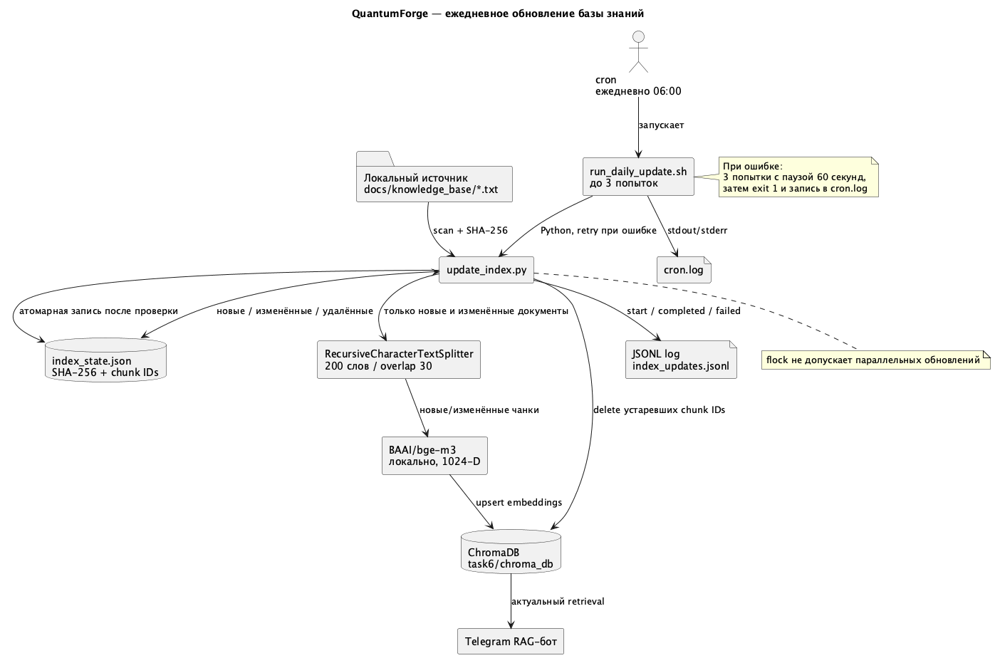

# Task 6: автоматическое ежедневное обновление базы знаний

Task 6 реализует инкрементальное обновление ChromaDB из реального локального
источника `docs/knowledge_base`. Каждый новый, изменённый или удалённый `.txt`
документ будет подхвачен при следующем запуске. Неизменённые документы повторно
не разбиваются на чанки и не отправляются в модель эмбеддингов.

## Результат

- источник: рекурсивный поиск `docs/knowledge_base/**/*.txt`;
- обнаружение изменений: SHA-256 содержимого, а не только дата файла;
- чанкинг: до 200 слов с перекрытием 30 слов, как в Task 3;
- эмбеддинги: локальная `BAAI/bge-m3`, 1024 измерения, L2 normalization;
- индекс: отдельная постоянная база `task6/chroma_db`;
- состояние: `task6/state/index_state.json` с хешами и ID чанков;
- лог: JSON Lines в `task6/storage/logs/index_updates.jsonl`;
- планировщик: пользовательский cron ежедневно в **06:00** по локальному времени;
- ошибки: до трёх попыток с интервалом 60 секунд и записью в `cron.log`;
- защита от гонок: `flock` не допускает два одновременных обновления.

Рабочий индекс уже создан: **137 документов, 203 чанка**. Повторный запуск без
изменений завершился за 0,083 секунды и сгенерировал **0** эмбеддингов.

## Структура

| Артефакт | Назначение |
|---|---|
| `update_index.py` | поиск изменений, чанкинг, embeddings, upsert/delete и JSON-логирование |
| `run_daily_update.sh` | cron-wrapper с тремя попытками и offline-режимом модели |
| `install_cron.sh` | безопасная установка задания без дубликатов |
| `cron/quantumforge-index.example` | пример строки crontab |
| `architecture.puml` | исходник архитектурной диаграммы PlantUML |
| `architecture.png` | отрендеренная диаграмма |
| `state/index_state.json` | состояние 137 документов и их chunk IDs |
| `storage/logs/index_updates.jsonl` | основной структурированный лог |
| `storage/logs/cron.log` | stdout/stderr и история повторных попыток cron |
| `storage/logs/error_example.jsonl` | проверенный пример `index_update_failed` |
| `demo/` | воспроизводимое добавление нового документа |
| `tests/test_update_index.py` | add/change/delete/no-op тест |

## Алгоритм обновления

1. Скрипт рекурсивно сканирует источник и вычисляет SHA-256 каждого `.txt`.
2. Хеши сравниваются с `state/index_state.json`.
3. Новые и изменённые документы разбиваются на чанки.
4. BGE-M3 вычисляет embeddings только для этих чанков.
5. Для изменённых и удалённых документов старые chunk IDs удаляются из ChromaDB.
6. Новые embeddings записываются через `upsert`.
7. Проверяется, что размер индекса совпадает с суммой чанков в state.
8. Только после успешной проверки state атомарно заменяется новым файлом.

Если процесс завершится после удаления старых чанков, но до записи state,
следующая попытка повторит операцию идемпотентно и восстановит нужные чанки.

## Ручной запуск

Один раз установите зависимости:

```bash
cd task6
uv sync
```

Запустите обновление:

```bash
HF_HUB_OFFLINE=1 TRANSFORMERS_OFFLINE=1 \
  ./.venv/bin/python update_index.py
```

Offline-переменные подходят, когда BGE-M3 уже находится в
`task2/embedding_model_cache`. Для первого скачивания модели запустите ту же
команду без них.

Посмотреть план изменений без записи в ChromaDB:

```bash
./.venv/bin/python update_index.py --dry-run
```

Полностью пересоздать только индекс Task 6:

```bash
HF_HUB_OFFLINE=1 TRANSFORMERS_OFFLINE=1 \
  ./.venv/bin/python update_index.py --rebuild
```

Task 3 при этом не изменяется.

## Ежедневный cron

На текущей машине установлено задание:

```cron
0 6 * * * /bin/sh /Users/sergey/work/yandex_practicum/ms_cource/architecture-pro-quantumforge/task6/run_daily_update.sh # quantumforge-task6-daily-index
```

Проверка:

```bash
crontab -l | grep quantumforge-task6-daily-index
```

Для установки на другой машине выполните:

```bash
cd task6
./install_cron.sh
```

Скрипт вычисляет абсолютный путь сам, сохраняет существующий crontab и не
добавляет вторую строку с тем же marker. Cron использует локальную временную зону
машины; на текущей машине это 06:00 Europe/Moscow.

### Поведение при ошибке

`run_daily_update.sh` выполняет до трёх попыток. Между ошибками он ждёт 60 секунд.
Каждая ошибка попадает одновременно:

- в `index_updates.jsonl` как `index_update_failed` с типом и текстом ошибки;
- в `cron.log` вместе с номером попытки и exit status.

После третьей неудачи wrapper возвращает код `1`, что позволяет подключить
внешний мониторинг cron. Ошибка одного запуска не повреждает state успешного
обновления.

Проверенный пример ошибки отсутствующего источника:

```json
{"event":"index_update_failed","error_count":1,"error_type":"FileNotFoundError","error":"source directory does not exist: /private/tmp/quantumforge-task6-missing-source"}
```

## Проверенная демонстрация нового документа

Демонстрация выполнена на `task6/demo/source`:

1. первый запуск проиндексировал только `alpha_station.txt` — 1 чанк;
2. затем был добавлен `daily_update.txt`;
3. второй запуск обнаружил 1 новый документ, создал 1 embedding и увеличил индекс
   с 1 до 2 чанков, не обрабатывая `alpha_station.txt` повторно;
4. третий запуск не нашёл изменений и создал 0 embeddings.

Дополнительный семантический поиск по демонстрационному индексу вернул новый
документ `Daily QuantumForge Update` первым с similarity `0.685773`.

Фактический фрагмент из `storage/logs/demo_updates.jsonl`:

```json
{"event":"index_update_completed","source_documents":2,"new_documents":1,"changed_documents":0,"deleted_documents":0,"unchanged_documents":1,"new_chunks":1,"embeddings_generated":1,"changes_detected":true,"error_count":0,"final_index_size":2}
```

Запуск с основной базой записал:

```json
{"event":"index_update_completed","source_documents":137,"new_documents":137,"new_chunks":203,"embeddings_generated":203,"error_count":0,"final_index_size":203}
```

## Тесты

```bash
cd task6
./.venv/bin/python -m unittest discover -s tests -v
```

Тест выполняет полный цикл: первоначальное добавление, no-op, изменение файла,
добавление второго файла и удаление первого. Для скорости используется
детерминированная fake embedding model; реальный BGE-M3 проверен демонстрационным
и основным запусками.

## Подключение индекса к Telegram-боту

Чтобы Task 4 использовал ежедневно обновляемый индекс:

```bash
cd task4
set -a
source .env
set +a
export RAG_INDEX_DIR=../task6/chroma_db
export RAG_SECURITY_MODE=all
HF_HUB_OFFLINE=1 TRANSFORMERS_OFFLINE=1 \
  ./.venv/bin/uvicorn quantumforge_bot.app:app --host 127.0.0.1 --port 8080
```

Для production обновление и чтение одного каталога ChromaDB разными процессами
нужно дополнительно согласовать на уровне deployment. В учебном локальном режиме
безопаснее перезапускать бот после успешного обновления индекса.

## Архитектура



Исходник: [`architecture.puml`](architecture.puml).
