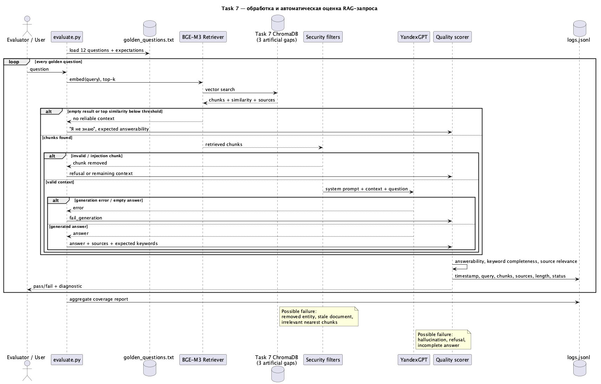

# Task 7: аналитика покрытия и качества базы знаний

Task 7 измеряет, какие темы RAG-бот знает, где он корректно отказывается и какие
нерелевантные источники retrieval возвращает при пробелах в корпусе. Production
индекс Task 6 не изменяется: для эксперимента создан отдельный индекс Task 7.

## Искусственные пробелы

`build_gap_index.py` копирует `task6/chroma_db` и исключает все чанки трёх
сущностей:

| Удалённая сущность | Удалено чанков |
|---|---:|
| Куратор Эйдос | 2 |
| Союз Зенор | 2 |
| Криос | 2 |

Исходный индекс содержит 203 чанка, экспериментальный — **197**. Состав и ID
удалённых чанков записаны в `gap_manifest.json`.

## Golden set

`golden_questions.txt` содержит 12 JSONL-записей:

- 8 вопросов по известным темам;
- 3 вопроса по искусственно удалённым сущностям;
- 1 вопрос о погоде как естественной границе домена.

Для каждого вопроса заданы ожидаемая answerability, ожидаемый ответ, релевантные
источники и ключевые слова. JSONL выбран вместо свободного текста, чтобы набор
одновременно читался человеком и автоматически валидировался.

## Что логируется

Каждый вызов в `logs.jsonl` содержит:

- `timestamp`, `question_id`, `topic`, полный `query`;
- `chunks_found`, число чанков выше порога и `top_similarity`;
- найденные источники и заголовки;
- полный ответ, `answer_length`, latency;
- `successful_answer`;
- keyword `completeness_score`;
- флаг релевантности источника;
- итоговые `status` и `correct`.

Правило успешного известного ответа: ответ не является отказом, имеет не менее 20
символов, содержит минимум половину обязательных ключевых слов и среди top-k есть
ожидаемый источник. Для отсутствующей темы успехом считается только корректный
отказ.

## Фактические результаты

Live-оценка YandexGPT завершилась со следующими метриками:

- общая точность: **12/12 (100%)**;
- известные темы: **8/8**;
- корректные отказы: **4/4**;
- релевантность ожидаемого источника: **100%**;
- средняя keyword completeness: **0.875**;
- покрытие in-domain тем: **8/11 (72.7%)**;
- подтверждено пробелов базы знаний: **3**;
- отдельно подтверждена 1 корректная граница домена — погода.

Несмотря на корректные отказы, retrieval вернул нерелевантные ближайшие документы:

- Эйдосы → `Собрание Арконов`, `Король Ирвис`, `Кочевники Пепла`;
- Союз Зенор → `Зерониды`, `Консул Орбитальной Коалиции`, `Орден`;
- Криос → `Крионцы`, `Парден Фейкор`, `Цервис`;
- погода → `Существо Талис`, `Парзар`, `Парден Фейкор`.

Полные ответы, источники и метрики находятся в [`logs.jsonl`](logs.jsonl), а
выводы и рекомендации — в [`REPORT.md`](REPORT.md).

## Запуск

Используется готовое окружение и `.env` Task 4:

```bash
cd task7

# Создать индекс с тремя искусственными пробелами
../task4/.venv/bin/python build_gap_index.py --rebuild

# Запустить 12 реальных RAG-запросов и перезаписать log/report
set -a
source ../task4/.env
set +a
HF_HUB_OFFLINE=1 TRANSFORMERS_OFFLINE=1 \
  ../task4/.venv/bin/python evaluate.py

# Проверить scoring без внешних API
../task4/.venv/bin/python -m unittest discover -s tests -v
```

`evaluate.py` вызывает платный YandexGPT API для известных вопросов. API-ключи и
Telegram-токены в аналитический лог не записываются.

## Анализ актуальности

В исходных документах отсутствуют `published_at`, `updated_at`, версия и URL
первоисточника. Поэтому актуальность фактов сейчас невозможно измерить
обоснованно: filesystem mtime показывает время локального копирования. В отчёте
это отмечено как отдельный metadata gap с рекомендацией добавить владельца,
источник и freshness SLA.

## Основные рекомендации

1. Восстановить статьи об Эйдосах, Союзе Зенор и Криосе.
2. Добавить метаданные актуальности и источник к каждому документу.
3. Группировать реальные Telegram-отказы по темам после удаления PII.
4. Запускать golden set после ежедневного обновления Task 6.
5. Блокировать deployment при регрессии answer accuracy, source relevance или
   refusal accuracy.

## Диаграмма последовательности



PlantUML-исходник: [`sequence.puml`](sequence.puml).
